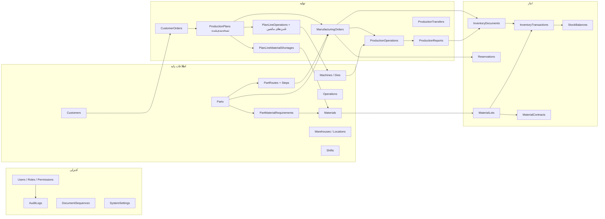
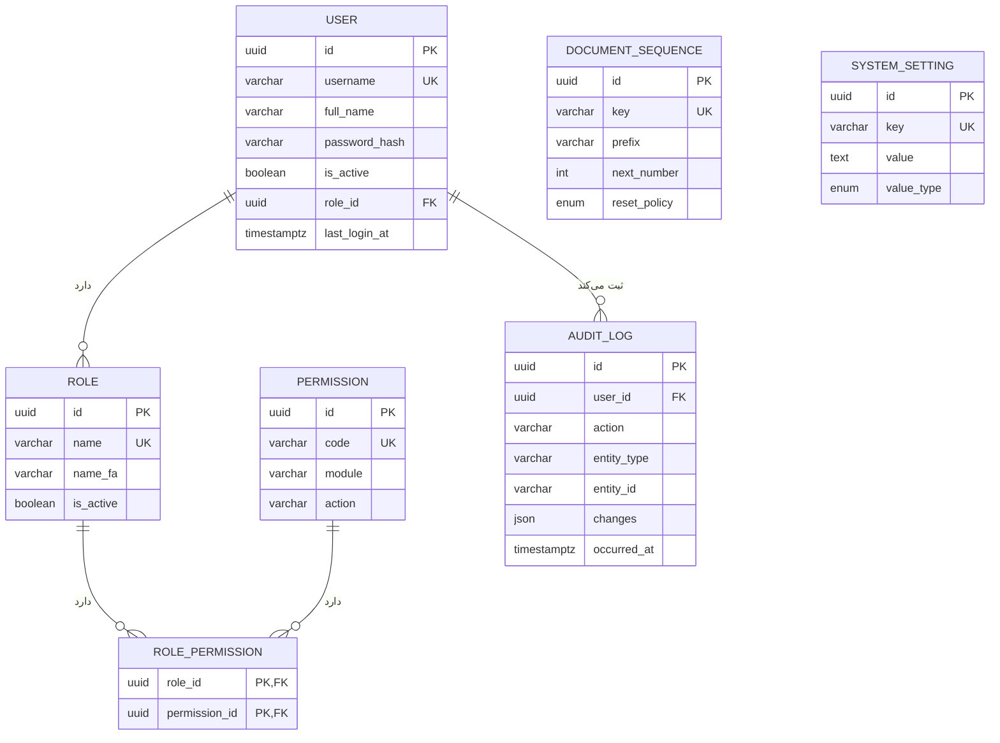
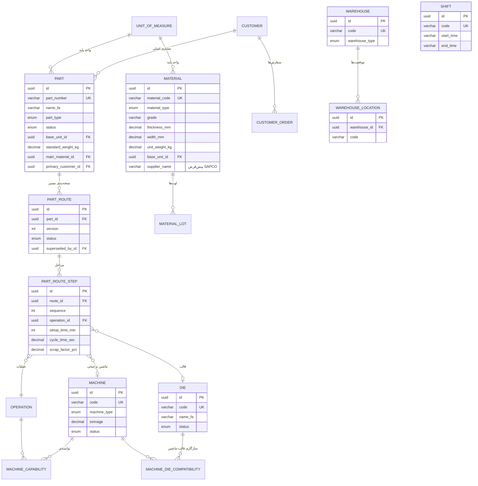
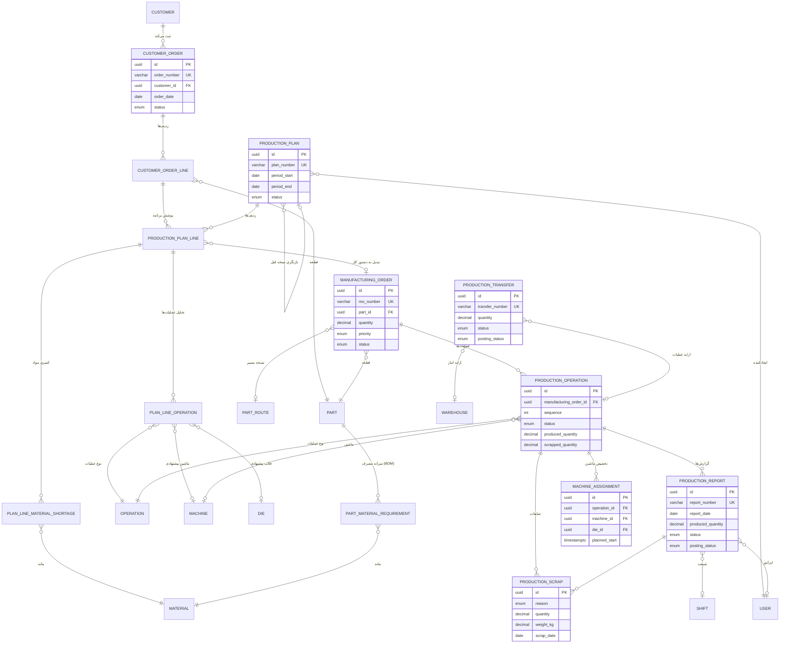
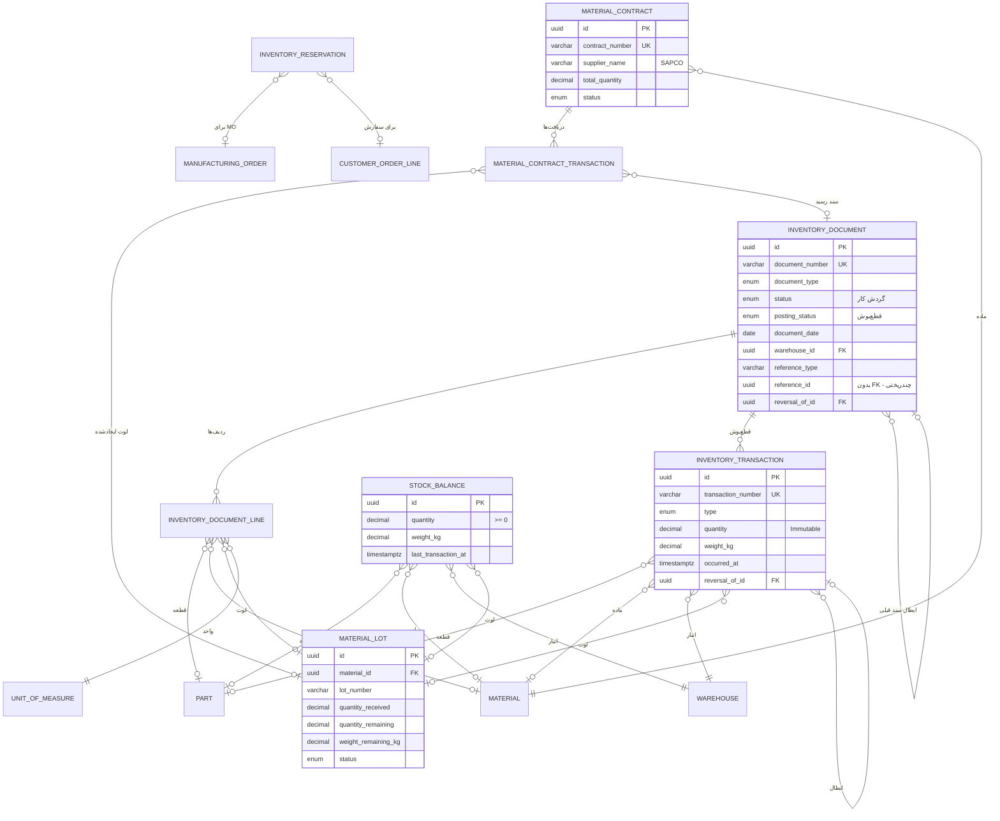
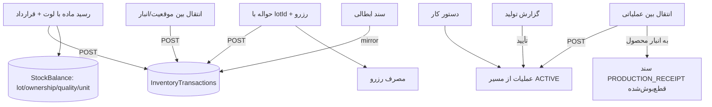
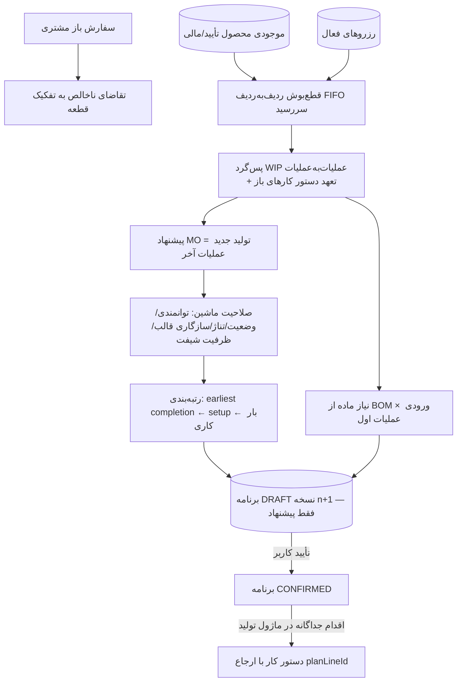

# KPIMS — نمودار روابط موجودیت‌ها (ER Diagram)

> نمودارها با Mermaid نوشته شده‌اند (در GitHub/GitLab و اکثر ابزارهای Markdown رندر می‌شوند).
> منبع حقیقت: `backend/prisma/schema.prisma` — جزئیات ستون‌ها در
> [`DATA-DICTIONARY.md`](./DATA-DICTIONARY.md) آمده است.

## ۱) نمای کلی دامنه‌ها (Domain Map)

## ۲) دامنه کنترلی (Control Data)

## ۳) اطلاعات پایه (Master Data)

## ۴) تولید (Production Data)

## ۵) انبار (Inventory Data)

## قیدهای یکپارچگی مهم (سطح دیتابیس)

| قید | محدوده | معنی |
|---|---|---|
| `chk_inv_tx_item` / `chk_stock_balance_item` / ... | تراکنش، ردیف سند، موجودی، رزرو | دقیقاً یکی از قطعه یا ماده اولیه (XOR) |
| `chk_inv_tx_qty_positive` | تراکنش انبار | تعداد همیشه مثبت (جهت در `type` است) |
| `chk_stock_balance_qty_non_negative` | موجودی رسمی | موجودی منفی ممنوع |
| `chk_inv_tx_reversal_self` / `chk_inv_doc_reversal_self` | دفتر کل | سند ابطال نمی‌تواند خودش باشد |
| `stock_balances_..._key` با `NULLS NOT DISTINCT` | موجودی | یکتایی ابعاد (قطعه/ماده، انبار، موقعیت، لوت) حتی با NULL |
| `ON DELETE RESTRICT` روی FKهای دفتر کل | انبار و تولید | اسناد قطع‌بوش‌شده حذف‌پذیر نیستند |

## ۹) الحاقات فازهای دو و سه (Inventory & Production)

فیلدهای افزوده‌شده به مدل‌های فاز یک (migrationهای `phase2_inventory_production_fields`،
`doc_line_lot_ownership_quality`، `stock_balance_unit` و `balance_unique_fix_reservation_check`):

### انبار
- `stock_ownership` (`OWNED` / `SUPPLIER_CONSIGNMENT`) و `quality_status`
  (`PENDING` / `APPROVED` / `BLOCKED`) روی **تراکنش، سطر موجودی و لوت** —
  جداسازی ورق امانی SAPCO و قرنطینه کیفیت به‌عنوان بخشی از هویت موجودی.
- `stock_balances.balance_key` — کلید یکتای قطعی برای upsert اتمی
  (به‌جای UNIQUE ترکیبی با NULL) + `unit_id` (موجودی به‌تفکیک واحد: عدد/کیلوگرم).
- `inventory_documents.reason_code / reason_text` — علت الزامی اصلاحیه (قاعده ۹).
- `inventory_document_lines.lot_number / ownership / quality_status / contract_id / reservation_id`.
- `adjustment_reason` enum: افتتاحیه، اصلاح شمارش، آسیب، کسری، اضافه، آزادسازی کیفیت، سایر.

### تولید و WIP
- `production_operations`: `received_quantity` (دریافتی از عملیات قبل)،
  `input_quantity` (خوراک ماشین، شامل تغذیه مجدد بازکار)، `rejected_quantity` (مردود)،
  `rework_quantity` (بازکار)، `transferred_out_quantity` (منتقل‌شده)،
  `wip_location_id` (موقعیت فیزیکی WIP) و `wip_since_at` (مبنای قداره).
- `production_reports`: `input_quantity` و `rejected_quantity` — با تساوی اجباری
  `input = produced + rejected + rework + scrap` در لایه سرویس.

### جریان‌های کلیدی

## ۱۰) الحاقات فاز چهار (برنامه‌ریزی تولید)

migration `phase4_planning` — همه تغییرات افزودنی هستند (بدون دستکاری داده‌های عملیاتی):

- **`operations.requires_die`** — عملیات‌های نیازمند قالب (BLK، FRM) برای کنترل سازگاری قالب–ماشین.
- **`part_route_steps.required_tonnage`** — حداقل تناژ پرس هر مرحله (شرط سخت صلاحیت ماشین؛
  اگر ثبت نشده باشد، برنامه‌ریز «کنترل تناژ انجام نشد» را صریحاً گزارش می‌کند — بدون فرض پنهان).
- **`part_material_requirements`** — BOM تک‌سطحی (سرانه مصرف ماده بر حسب واحد پایه ماده به ازای یک قطعه)
  ورودی محاسبه کسری مواد.
- **`production_plans`** — `version`، `revision_of_id` (زنجیره نسخه‌ها)، `planning_run_at`،
  `planning_params` (افق/بازه سررسید/شیفت‌های استفاده‌شده) و `summary` (خلاصه اسنپ‌شات اجرا)؛
  وضعیت جدید `SUPERSEDED` برای نسخه‌های جاگزیده‌شده.
- **`production_plan_lines`** — خروجی قطع‌بوش هر ردیف: `gross_quantity`، `covered_by_stock`،
  `covered_by_reservations`، `covered_by_wip`، `covered_by_planned_mos`، `planned_quantity`
  (پیشنهاد MO)، `route_id/version`، `due_date`، `feasible` و `detail` (JSON اسنپ‌شات کامل:
  ردیف‌های تقاضا، زنجیره WIP، هشدارها، اطلاعات ناقص).
- **`plan_line_operations`** — زنجیره کمیت عملیات‌به‌عملیات (`required_output/wip_used/
  committed_used/arriving_used/must_produce/required_input`) + منبع زمان (`time_source`,
  `setup_source`)، صلاحیت (`feasible`, `infeasible_reasons`, `missing_info`) و پیشنهاد ماشین
  (`recommended_machine_id/code`, `recommended_rank`, `candidates` JSON با دلایل رتبه‌بندی).
- **`plan_line_material_shortages`** — کسری هر ماده با شدت (`OK` / `SHORTAGE_COVERED_BY_CONTRACT`
  / `SHORTAGE` / `MISSING_BOM`)، سهم امانی SAPCO و پوشش قراردادهای باز.

### جریان برنامه‌ریزی (فاز ۴)

